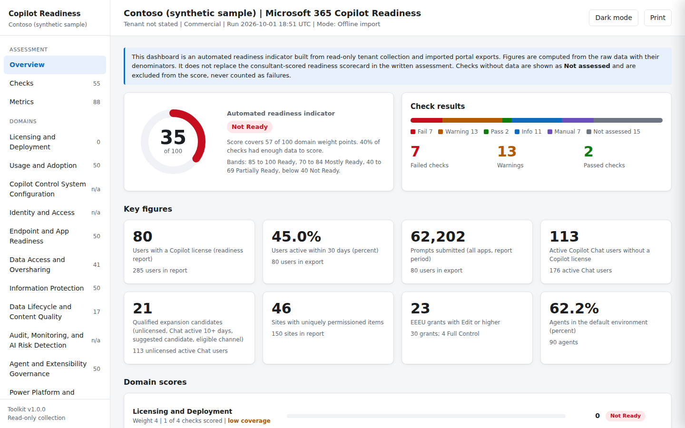

# Microsoft 365 Copilot Readiness Assessment Toolkit

Read-only PowerShell toolkit that gathers Microsoft 365 Copilot readiness evidence from a tenant, recognizes the portal exports that have no API, and produces:

- a self-contained **HTML dashboard** (overview score, domain scores, filterable checks with a details panel, metrics, data coverage, evidence inventory, diagnostics, light and dark mode, printable, works offline), and
- **CSV exports** for every metric, check, domain score, dataset, and evidence file, plus the normalized source data.

It supports the Discover phase of a Copilot readiness, enablement, and expansion engagement. The dashboard is an automated readiness indicator; it does not replace the consultant-scored scorecard in the written assessment.



## How it works

```
 Read-only collection (optional)          Portal exports (no API)            Analysis                Output
 ---------------------------------        ------------------------           ----------------        -------------------------
 Microsoft Graph                          Copilot readiness, Copilot         Metrics with            CopilotReadinessDashboard.html
 SharePoint Online (+ DAG reports)  --->  Chat, Copilot Search, Viva   --->  denominators     --->   csv/metrics.csv, checks.csv,
 Security & Compliance (Purview)          Insights, DSPM, Agents,            55 checks across        domain-scores.csv, ...
 Exchange Online (audit)                  Power Platform inventory,          15 domains              csv/data/<dataset>.csv
 Power Platform, Fabric                   SharePoint DAG, Active sites                               manifest.json, run.log
```

Portal exports are recognized by their **column headers**, not by file name, so renamed files still import. Every file in the evidence folder is inventoried with its SHA-256 hash.

## Quick start

```powershell
# PowerShell 7.2 or later
git clone https://github.com/NeoCore3/M365-copilot-assessmentToolkit-V1.0.git
cd M365-copilot-assessmentToolkit-V1.0

# 1. Try it with synthetic data (no tenant, no sign-in)
./tests/New-SampleEvidence.ps1 -Path ./sample-evidence
./Invoke-CopilotReadinessAssessment.ps1 -CustomerName 'Contoso' -EvidencePath ./sample-evidence -OfflineOnly

# 2. Analyze a client's portal exports only
./Invoke-CopilotReadinessAssessment.ps1 -CustomerName 'Client' -EvidencePath 'E:\Client\Discovery Documents' -OfflineOnly

# 3. Full run: collect from the tenant and import the portal exports
./Install-Prerequisites.ps1
./Invoke-CopilotReadinessAssessment.ps1 -TenantId <tenant-guid> -CustomerName 'Client' `
    -EvidencePath 'E:\Client\Discovery Documents' `
    -SharePointAdminUrl https://client-admin.sharepoint.com -AdminUpn reader@client.com
```

Open `output/<Customer>-<timestamp>/CopilotReadinessDashboard.html` in any browser.

## Parameters

| Parameter | Purpose |
|---|---|
| `-TenantId` | Tenant GUID. Required unless `-OfflineOnly`. The signed-in tenant must match. |
| `-CustomerName` | Shown on the dashboard and used in the output folder name. |
| `-Cloud` | `Commercial` (default), `GCC`, or `GCCHigh`. See [docs/SETUP.md](docs/SETUP.md). |
| `-EvidencePath` | One or more folders with portal exports (CSV, XLSX) and screenshot packs (DOCX). Searched recursively. |
| `-OutputPath` | Parent folder for results. Default `./output`. |
| `-Collect` | `All` (default) or any of `Graph, SharePoint, Purview, Exchange, PowerPlatform, Fabric`. |
| `-OfflineOnly` | No sign-in. Import and analyze evidence files only. |
| `-AdminUpn` | Pre-fills the Exchange and Security & Compliance sign-in. |
| `-SharePointAdminUrl` | `https://<tenant>-admin.sharepoint.com`. SharePoint collection is skipped without it. |
| `-DagMode` | `None` (default), `Start` (request SharePoint data access governance reports), or `Export` (download completed reports and import them). |
| `-AuditDays` | Window for the CopilotInteraction audit sample. Default 7. |
| `-IncludeRowPreview` | Embeds the first 25 rows of each dataset in the dashboard. Off by default because it puts identifiers into the HTML. |

## What is collected and what must be exported

The full matrix is in [docs/COVERAGE.md](docs/COVERAGE.md). In short:

- **Collected by API or PowerShell:** licenses and users, Copilot usage (Commercial and GCC), Conditional Access, security defaults, directory roles (including AI Administrator), SharePoint tenant settings and site inventory, data access governance reports (with SharePoint Advanced Management), sensitivity labels, DLP, auto-labeling, retention, unified audit state and a CopilotInteraction sample, Copilot admin catalog, Secure Score, Power Platform environments and inventory, Fabric tenant settings.
- **Imported from portal exports (no API exists):** Copilot readiness, Copilot Chat (unlicensed) usage, Copilot Search usage, Agents usage and registry, Viva Insights Copilot Dashboard, Purview DSPM exports (Activity explorer, Apps, Agents, data risk assessment, AI observability), SharePoint Active sites, and Power Platform inventory exports. [docs/EVIDENCE.md](docs/EVIDENCE.md) lists the portal path for each.
- **Manual (no API or export):** Copilot settings and Optimize page, agent sharing settings, Restricted Access Control and SharePoint Advanced Management policies, Insider Risk policies, AI governance operating model. These appear as `Manual` checks with the portal location to verify.

## Evidence rules built in

- Every figure is recomputed from the raw data and carries its denominator and source file.
- Different exports taken on different dates are treated as different populations. Where two sources measure the same thing (for example directory versus readiness report license counts), both values and the delta are reported.
- Missing data produces `NO DATA AVAILABLE` and a `Not assessed` check, never a failure and never an assumed value.
- Portal exports that are capped (for example Activity explorer at 10,000 rows) are labeled as samples.
- References are Microsoft Learn only.

## Scoring

Pass = 1, Warning = 0.5, Fail = 0, weighted by risk (Critical 4, High 3, Medium 2, Low 1). Domain scores are combined with domain weights (Data Access and Oversharing 13, Identity 10, Information Protection 10, Audit 8, and so on) and renormalized over the domains that could be assessed. Bands: 85 to 100 Ready, 70 to 84 Mostly Ready, 40 to 69 Partially Ready, below 40 Not Ready. Each domain shows how many checks were scored and flags low coverage. Thresholds are listed in [docs/CHECKS.md](docs/CHECKS.md).

## Output folder

```
<Customer>-<yyyyMMdd-HHmmss>/
  CopilotReadinessDashboard.html   self-contained dashboard
  csv/metrics.csv                  every metric with value, denominator, source, note
  csv/checks.csv                   55 checks with status, finding, recommendation, threshold, Learn links
  csv/domain-scores.csv            per-domain score, rating, and status counts
  csv/collection-status.csv        every dataset: collected, imported, failed, unsupported, and why
  csv/evidence-inventory.csv       every evidence file with SHA-256 and recognized dataset
  csv/diagnostics.csv              errors with guidance
  csv/data/<Dataset>.csv           normalized source data
  raw/                             raw API responses (JSON) and downloaded DAG reports
  manifest.json, run.log
```

## Security and data handling

- Collection is read-only and delegated (interactive sign-in). No secrets, certificates, or app registrations are created or stored.
- Output contains tenant data (user principal names, site URLs, agent names). Keep it in the client's evidence location. `.gitignore` excludes `output/` and evidence folders; never commit client data to this repository.
- CSV cells that start with `=`, `+`, `-`, or `@` are prefixed to prevent formula injection when opened in Excel.
- The dashboard loads no external scripts, fonts, or images.

## Documentation

- [docs/SETUP.md](docs/SETUP.md): modules, roles, Graph scopes, clouds
- [docs/COVERAGE.md](docs/COVERAGE.md): API versus import matrix with Microsoft Learn references
- [docs/EVIDENCE.md](docs/EVIDENCE.md): how to export each portal report and the headers used to recognize it
- [docs/CHECKS.md](docs/CHECKS.md): all checks, thresholds, and data sources
- [docs/TROUBLESHOOTING.md](docs/TROUBLESHOOTING.md)

## Testing

```powershell
./tests/Test-Toolkit.ps1    # parses all scripts, generates synthetic evidence, runs offline, asserts results
```

The GitHub Actions workflow runs the same test on Windows and Linux.

## Limitations (v1.0)

- Live collectors were built against Microsoft Learn documentation and have not yet been run against every tenant configuration; the import, analysis, and report engine is tested with synthetic and real portal exports.
- Power Platform and Fabric API collection is enabled for Commercial only; use the portal exports in GCC and GCC High.
- Copilot usage report APIs are not available in GCC High; import the portal export instead.
- PIM-eligible role assignments are not counted.
